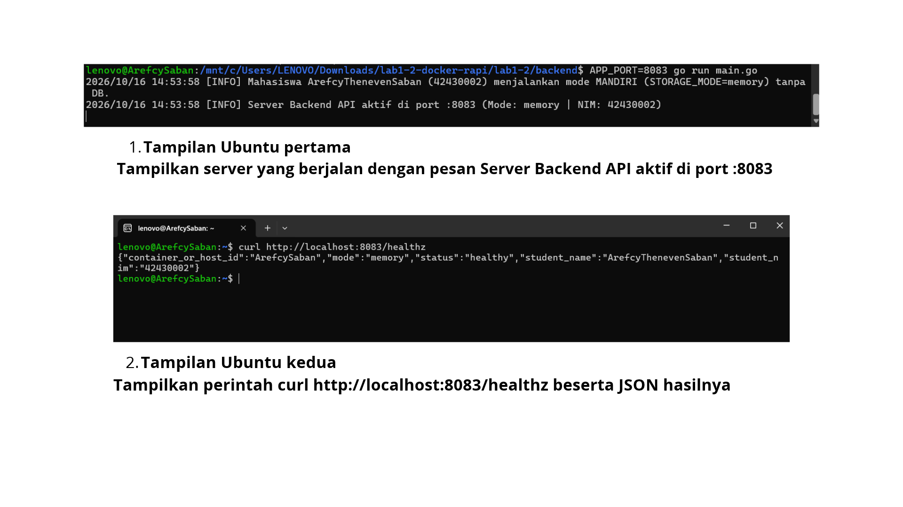
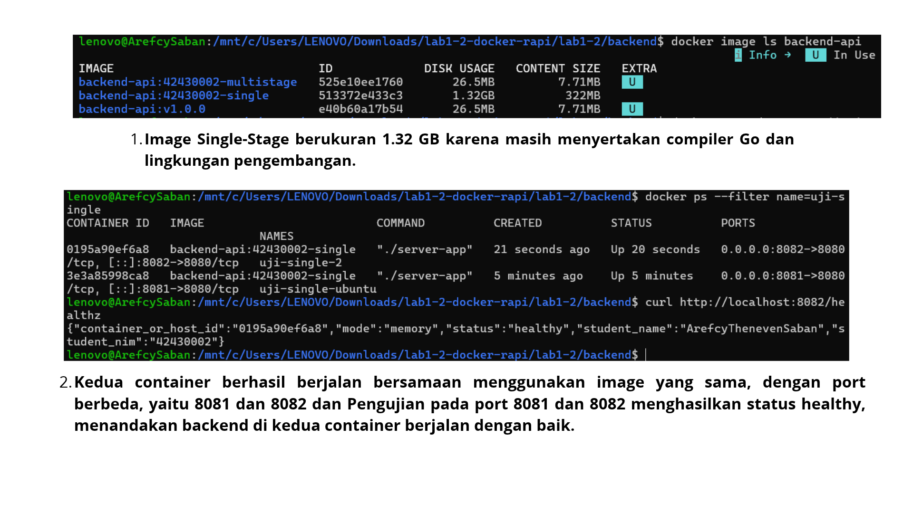
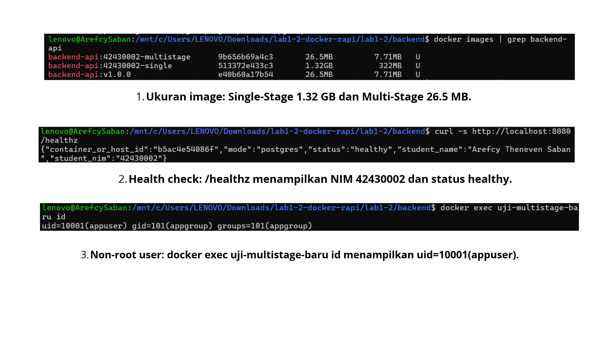
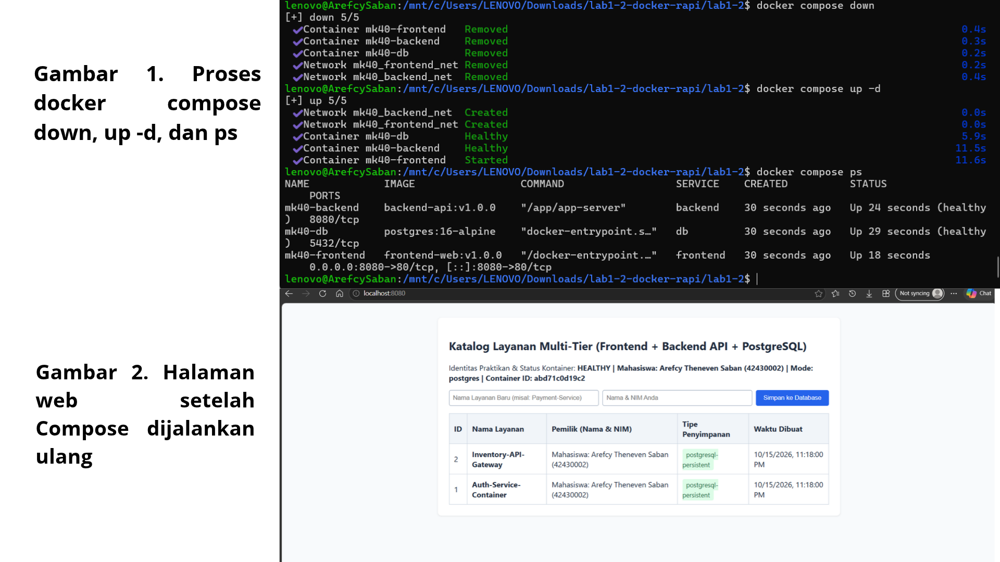
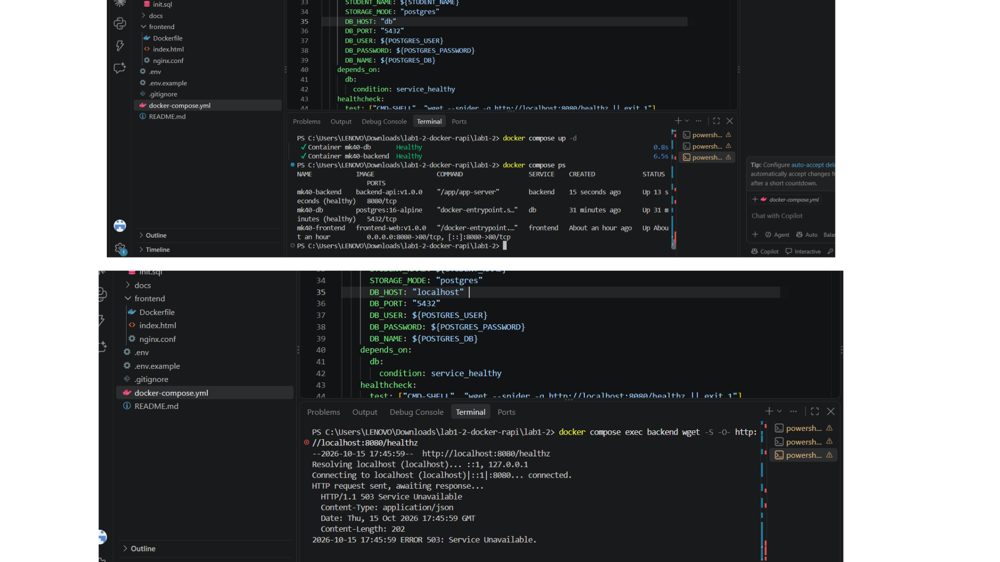
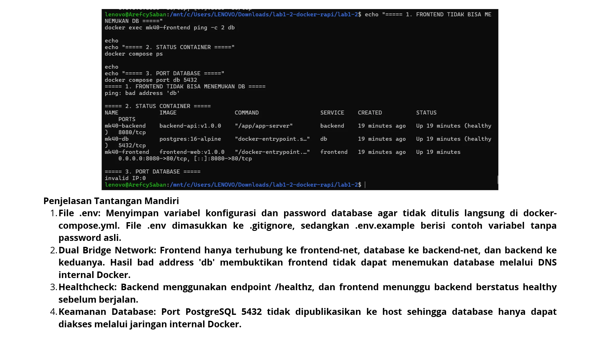

# Laporan Praktikum Modul 1 (Pertemuan 4): Kontainerisasi Docker & Orkestrasi Multi-Tier (Lab 1 & Lab 2)

- **Nama Mahasiswa**: Arefcy Theneven Saban
- **NIM**: 42430002
- **Kelas / Prodi**: S1 Teknologi Informasi – UNDIKNAS Denpasar
- **Tautan Branch / Pull Request GitHub**: https://github.com/andriyantoay595-art/lab1-2-docker/tree/tugas-docker
- **Nama Rekan Peer-Reviewer**: Rosan Kelvino Andre (42430025)

---

## 1. Tabel Komparasi Eksperimen Individu

| Parameter | Tahap 1: Tanpa Docker | Tahap 2: Single-Stage | Tahap 3: Multi-Stage |
| :--- | :--- | :--- | :--- |
| Instalasi Go di Host | Wajib | Tidak wajib | Tidak wajib |
| Ukuran Image | - | `1.32 GB` | `26.5 MB` (target < 100 MB) |
| `container_or_host_id` & NIM | Hostname: `ArefcySaban` / NIM: `42430002` | Container ID: `fdffde0b9707` / NIM: `42430002` | Container ID: `66927bc1ff09` / NIM: `42430002` |
| User proses (`id`) | User laptop | `uid=0 (root)` | `uid=10001 (appuser)` |
| 2 instansi sekaligus | Gagal (port sama) | Berhasil (8081 & 8082) | Berhasil |

---

## 2. Bukti Screenshot & Penjelasan

### A. Tahap 1 – Tanpa Docker

**Penjelasan**: Aplikasi Go dijalankan langsung pada komputer host menggunakan go run main.go. Nilai container_or_host_id menunjukkan hostname komputer karena aplikasi berjalan langsung pada host. Ketika aplikasi kedua dijalankan pada port 8080 yang sama, proses tersebut gagal karena port sudah digunakan oleh aplikasi pertama.

### B. Tahap 2 – Single-Stage

**Penjelasan**: Pada metode single-stage, proses kompilasi dan aplikasi dijalankan menggunakan satu tahap image yang menggunakan Go. Metode ini sederhana, tetapi image yang dihasilkan lebih besar karena lingkungan build ikut berada dalam image akhir.

### C. Tahap 3 – Multi-Stage (< 100 MB)

**Penjelasan**: Penggunaan multi-stage build berhasil mengurangi ukuran image dari sekitar 1,32 GB menjadi 26,5 MB, atau sekitar 98%. Instruksi COPY --from=builder berfungsi menyalin hasil kompilasi aplikasi dari tahap builder ke tahap production tanpa menyertakan seluruh compiler Go dan lingkungan build. Layer caching memungkinkan Docker menggunakan kembali layer yang tidak berubah sehingga proses build berikutnya dapat lebih cepat. Selain itu, penggunaan USER appuser dengan UID 10001 membuat aplikasi berjalan sebagai pengguna non-root untuk mengurangi risiko keamanan dan membatasi hak akses aplikasi

### D. Tahap 4 – Docker Compose & Persistensi

**Penjelasan**:  Pada tahap ini, Docker Compose menjalankan tiga layanan yang saling terhubung, yaitu Frontend, Backend, dan Database (DB). Frontend menerima permintaan dari pengguna, kemudian meneruskannya ke Backend melalui konfigurasi Nginx. Backend memproses permintaan dan berkomunikasi dengan Database untuk menyimpan atau mengambil data. Named volume pgdata berfungsi menyimpan data PostgreSQL agar tetap tersedia meskipun kontainer database dihentikan, dihapus, atau dibuat ulang. Dengan demikian, data tidak hanya tersimpan di dalam kontainer, tetapi juga dapat dipertahankan selama volume tersebut tidak dihapus.

### E. Tahap 5 – Troubleshooting

**Penjelasan**: Pada tahap troubleshooting, localhost di dalam kontainer Backend mengacu pada kontainer Backend itu sendiri, bukan ke kontainer Database. Oleh karena itu, Backend harus menggunakan hostname db sebagai nilai DB_HOST agar dapat terhubung ke layanan Database melalui jaringan Docker Compose. Selain itu, perintah docker compose down -v perlu digunakan dengan hati-hati karena opsi -v akan menghapus named volume yang digunakan oleh Database, termasuk volume pgdata. Jika volume tersebut dihapus, data PostgreSQL yang tersimpan di dalamnya dapat hilang secara permanen. Untuk menjaga data tetap aman, gunakan docker compose down tanpa opsi -v ketika ingin menghentikan dan menghapus kontainer tanpa menghapus named volume.]

### F. Tantangan Mandiri

**Penjelasan**:  Pada tahap tantangan mandiri, konfigurasi dual bridge network digunakan untuk memisahkan komunikasi antar layanan. Frontend terhubung ke frontend-net, sedangkan Database terhubung ke backend-net. Backend terhubung ke kedua jaringan tersebut sehingga dapat menerima permintaan dari Frontend dan berkomunikasi dengan Database tanpa membuat Frontend terhubung langsung ke Database. File .env digunakan untuk menyimpan konfigurasi seperti port dan kredensial agar lebih mudah dikelola tanpa menuliskannya langsung di file konfigurasi utama. Selain itu, healthcheck pada Backend digunakan untuk memeriksa apakah aplikasi berjalan dengan baik sehingga Docker Compose dapat mengetahui status kesehatannya sebelum layanan lain bergantung padanya.

---

## 3. Bukti Peer-Review
- **Tautan PR**: `https://github.com/.../pull/...`
- **Catatan Reviewer**: [...]
